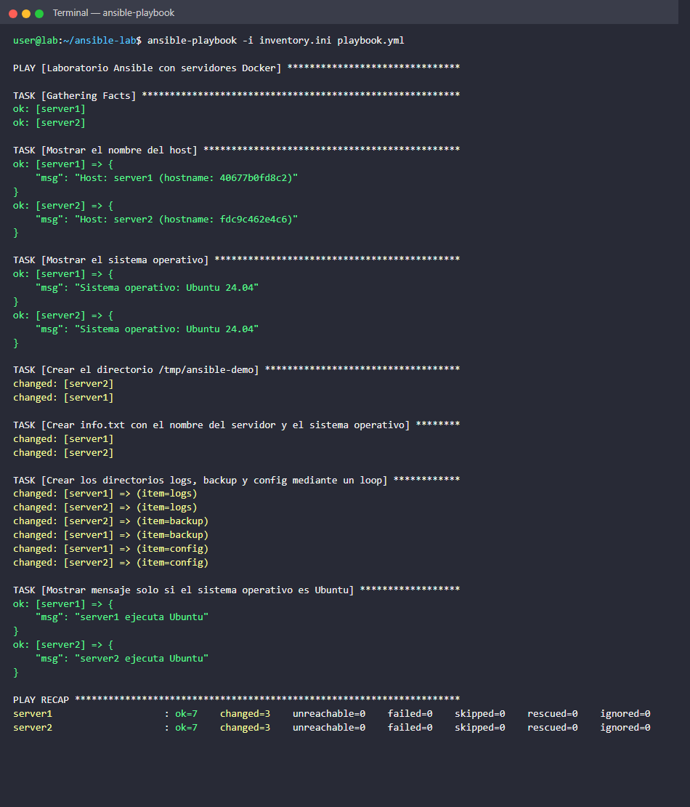

# Laboratorio Ansible con Docker

## Objetivo de la práctica

Crear un laboratorio con dos servidores Linux (Ubuntu 24.04) usando contenedores Docker y administrarlos con Ansible. Usamos el plugin de conexión `docker`, así que no hace falta SSH. El playbook:

- Muestra el nombre del host y el sistema operativo de cada servidor.
- Crea el directorio `/tmp/ansible-demo`.
- Crea `info.txt` con el nombre del servidor y el sistema operativo.
- Crea con un `loop` los directorios `logs`, `backup` y `config`.
- Muestra un mensaje solo cuando el sistema operativo es Ubuntu (`when`).

## Estructura

```
ansible-lab/
├── docker-compose.yml   # Definición de server1 y server2
├── inventory.ini        # Inventario con conexión docker
├── playbook.yml         # Tareas a ejecutar
└── README.md
```

## Iniciar los contenedores

```bash
cd ansible-lab
docker compose up -d
docker ps
```

Instalar Python en cada contenedor (Ansible lo necesita para ejecutar sus módulos):

```bash
docker exec -it server1 bash -c "apt update && apt install -y python3"
docker exec -it server2 bash -c "apt update && apt install -y python3"
```

## Comprobar la conexión

```bash
ansible docker -i inventory.ini -m ping
```

## Ejecutar el playbook

```bash
ansible-playbook -i inventory.ini playbook.yml
```

Verificar el resultado en un servidor:

```bash
docker exec server1 ls /tmp/ansible-demo
docker exec server1 cat /tmp/ansible-demo/info.txt
```

> **Nota (Windows):** Ansible no funciona como nodo de control en Windows. Puedes ejecutarlo desde WSL o desde un contenedor que tenga Ansible y el cliente de Docker, montando el socket de Docker:
>
> ```bash
> docker run --rm -v /var/run/docker.sock:/var/run/docker.sock -v "$PWD:/lab" -w /lab \
>   <imagen-con-ansible-y-docker-cli> ansible-playbook -i inventory.ini playbook.yml
> ```

## Captura de la ejecución exitosa



## Detener el laboratorio

```bash
docker compose down
```
